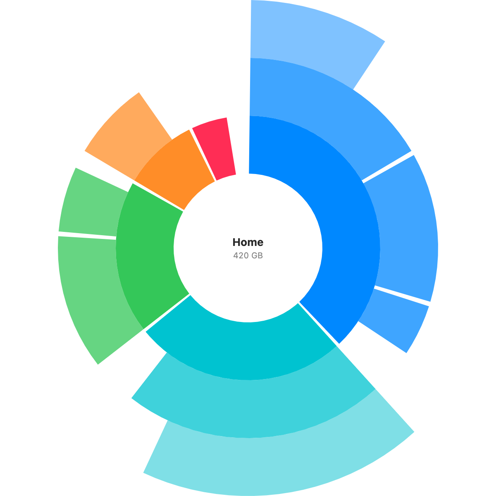
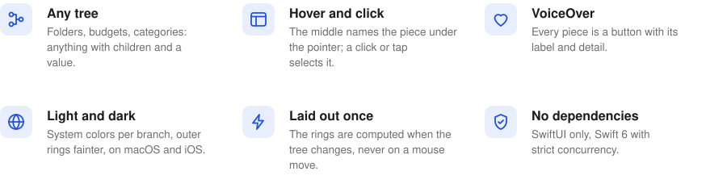

<p align="center">
  
</p>

A sunburst chart for SwiftUI: a tree as rings around its root, each piece as wide as its share of its parent. Hover
names the piece in the middle, a click or tap selects it, and VoiceOver reads every piece as a button.

<p align="center">
  <picture>
    <source media="(prefers-color-scheme: dark)" srcset="assets/preview-dark.png">
    
  </picture>
</p>

## What it does

<picture>
  <source media="(prefers-color-scheme: dark)" srcset="assets/pictures/features-dark.svg">
  
</picture>

## Install

Swift 6, macOS 14 or iOS 17. In `Package.swift`, then add the product `SunburstChart` to your target:

```swift
dependencies: [.package(url: "https://github.com/Robertwlt03/swiftui-sunburst", from: "0.1.0")]
```

## Use

Any `Identifiable` type works; say how to reach its children, its value and its name:

```swift
import SunburstChart
import SwiftUI

struct Folder: Identifiable {
    let id: String
    let size: Double
    var children: [Folder] = []
}

struct FolderChart: View {
    let home: Folder
    @State private var opened: Folder?

    var body: some View {
        SunburstChart(
            root: home, children: \.children, value: \.size, label: \.id,
            detail: { folder in "\(Int(folder.size)) GB" },
            onSelect: { folder in opened = folder })
            .padding()
    }
}
```

A parent's value covers its children; what they leave free stays a gap, so the gaps show what lies in the parent
itself. Pieces thinner than 0.4 % of the circle are left out with their children, because nobody could see or click
them.

## Options

| Parameter | Default | What it does |
|---|---|---|
| `detail` | empty | a second line in the middle and VoiceOver's value, such as a formatted size |
| `rings` | `3` | how many rings are drawn around the root |
| `colors` | system colors | one color per branch (child of the root), repeating when there are more |
| `revision` | `0` | change it when the tree's contents change but the root's identity stays |
| `onSelect` | nothing | what a click, a tap or VoiceOver's action on a piece does |

`SunburstLayout` computes the rings without drawing them, for a chart of your own or for tests.

## Contribute

Issues and pull requests are welcome. The tests check the layout; the README's pictures are drawn by a test too:

```bash
swift test
```

```bash
SUNBURST_PREVIEW=$PWD/assets/preview swift test --filter drawPreview
```

## License

[MIT](LICENSE)
